**G087 신형섭**

# 운영 인시던트 대응 에이전트

기존 서비스의 FastAPI·Vue·LangGraph·MCP 구조를 유지하면서 **조회 대상의 추측을 막고, 런북을 의미로 검색하며, 조사 근거와 대화 기억을 검증 가능한 형태로 관리**했다. 기능 추가뿐 아니라 같은 입력의 비교와 실패 사례를 함께 남겼다.

> 검증 환경은 **로컬 Qwen 기반**이다. 모니터링·로그는 합성 데모 데이터이며 실제 운영 장애의 원인을 확인한 결과가 아니다. OpenAI 추가 검증은 계획 단계다. Qwen 장기 기억의 새 사례 2건은 실패했으며 해결 완료로 표시하지 않는다.

## 관련 문서

| 자료 | 목적 |
|---|---|
| [서비스 실행 가이드](doc/README.md) | 설치, 실행, 모드 선택과 설정 설명 |
| [통합 검증 상세](doc/ppt/s6_integration_report.md) / [비교 CSV](doc/ppt/s6_comparison.csv) | 조건과 분모를 구분한 검증 결과 |
| [Judge 평가 상세](doc/ppt/s5_evaluation_report.md) / [한계](doc/ppt/limitations.md) | 평가기 자체 검증과 미해결 문제 |

## 1. 진행 사항과 개선 범위

**선택 과제: 과제 1 — 기존 Base AI Agent 개선.** 추가·수정 task는 **#1 RAG, #3 Research 멀티 에이전트, #5 메모리, #6 LLM-as-a-Judge, #7 하드코딩 개선**이다. 기존 API·UI·MCP 연결을 기반으로 대상 정책, 조사·검색, 대화 기억과 평가 기능을 확장했다.

운영 진단 에이전트는 자연스러운 답변보다 **어떤 시스템을 실제로 조회했는지, 어떤 근거로 판단했는지**가 먼저 확인되어야 한다. 기존 구현을 분석하며 다음 다섯 문제를 개선 대상으로 정했다.

| 개선 영역 | 기존 문제 | 구현한 변경 | 주요 서비스 코드 |
|---|---|---|---|
| 설정·대상 정책 | 기본 대상 추정과 분산된 프롬프트·정책 | `config/agent.json` 외부화, 공통 대상 식별, strict 가드 | [설정](agent/config.py), [대상 정책](agent/target_resolver.py) |
| RAG | 영어 키워드·규칙 우선순위에 의존하는 런북 유형 선택 | E5 임베딩·Chroma 검색, 임계값·margin, 불확실하면 보류 | [인덱서](agent/rag/indexer.py), [검색기](agent/rag/retriever.py) |
| 멀티 에이전트 | 단일 조사 노드 안에 수집·해석·실패가 섞임 | 지표·로그·런북 compiled subgraph와 Supervisor 통합 | [조사 Supervisor](agent/research/supervisor.py), [전문 그래프](agent/research/) |
| 메모리 | 최근 메시지 창 밖의 초기 사실을 잃을 수 있음 | 원문 보존·증분 요약·체크포인트·실패 fallback | [메모리](agent/memory.py), [SQLite](agent/session_store.py) |
| 평가 | 응답의 그럴듯함만으로 근거 정확성을 판단하기 어려움 | 결정적 검사 + 별도 LLM Judge, 캐시·출력 검증·사람 판정 비교 | 오프라인 평가 도구는 로컬 보관, [최종 결과](doc/ppt/s5_evaluation_report.md) 공개 |

**기반 구조와 확장 기능.** FastAPI 수명 관리, Vue/SSE, LangGraph 메인 파이프라인, MCP 다중 서버 탐색, `SupervisorDeps` 의존성 주입, LangSmith 연동, transient 재시도는 기반 기능이다. 이 구조를 재사용하고 위 다섯 기능과 서비스 단위 테스트를 확장했다. S6에서는 실제 검증으로 발견한 **SSE 중단 전파·자원 정리 결함**도 수정했다.

Human-in-the-loop 승인 노드, 실제 운영 로그 연동, 위험 조치 자동 실행은 구현 범위에 포함하지 않았다. 답변의 조치는 미실행 권고다.

## 2. 전체 동작 구조

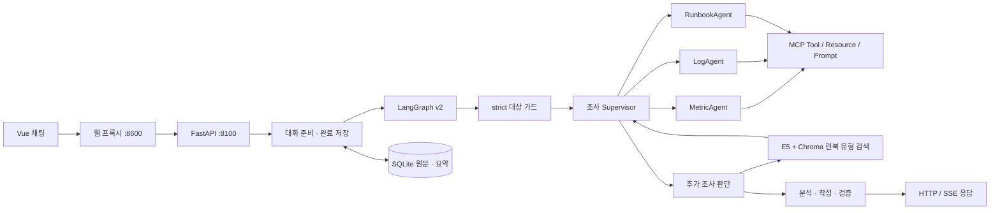

이 그림은 책임 관계를 요약한다. 실제 진입 노드는 `route`이고, 현재 질문의 대상 정책·일반 대화·장애 진단을 분기한다. RAG는 모든 질문에서 호출되지 않는다. **수집된 모니터링에 비해 런북이 부족할 때** 재계획 단계에서 유형을 제안하고, 선택된 본문은 MCP Resource로 조회한다. 일반 대화는 조사 파이프라인을 건너뛴다. [상세 메인 그래프](agent/graph.py)

## 3. 개선 내용과 설계 이유

### 3.1 대상 가드와 설정 외부화

`data/monitoring.json`의 등록 시스템을 기준으로 현재 질문에 명시된 대상을 식별한다. strict 모드는 미등록·미명시 대상을 다른 서버로 대체하지 않고 확인을 요청한다. 여러 시스템을 명시하면 허용된 대상을 모두 보존한다. 프롬프트 지시만으로 통제하지 않고 **계획 보정과 Tool 호출 경계의 코드 검사**를 함께 유지했다.

프롬프트와 정책은 `config/agent.json`, 실행 모드는 환경변수로 분리했다. `/health`에는 적용 모드와 설정 원본 해시를 노출한다. 해시는 비밀키가 아니며, 환경변수 전체를 포함한 해시도 아니다. 변경 반영에는 서버 재시작이 필요하다.

### 3.2 런북 의미 검색

짧은 런북 Markdown **6개를 문서 단위로** 임베딩했다. 모델은 `intfloat/multilingual-e5-small`, 차원은 384이며 모델 revision과 문서 해시·prefix를 인덱스 정체성에 포함했다. `passage: `로 문서를, `query: `로 모니터링의 상태·알림을 인코딩한다.

검색은 `1 - cosine distance` 점수로 순위를 매긴다. 현재 설정의 `top_k=3`, `threshold=0.8`, `margin=0.01`을 사용해 1위 점수와 1·2위 차이를 모두 만족해야 채택한다. 점수는 확률이 아니다. 낮은 신뢰도는 추가 증상 요청으로 처리하며, 인덱스가 없거나 문서·모델과 다르면 재구축 오류를 표시한다. 임의의 `db-down` 런북으로 대체하지 않는다.

### 3.3 전문 조사와 근거 계약

`MetricAgent`, `LogAgent`, `RunbookAgent`는 각각 수집→검증/해석→결과 또는 skip 경로를 가진 **별도의 compiled StateGraph**다. 여기서 Agent는 독립적인 책임과 실행 그래프를 뜻한다. 세 Agent가 각각 LLM을 반드시 호출하는 구조는 아니다.

결과는 `id / source / system / timestamp / payload / synthetic` 근거와 성공·부분·실패 상태를 보존한다. 로그가 실패하면 성공한 다른 근거로 부분 보고서를 만든다. 지표가 없으면 수치를 생성하거나 런북 유형을 추측하지 않는다. 로그·지표 시각이 어긋나면 상관관계를 확정할 수 없다고 알린다.

전문 그래프는 병행 실행하지만 **MCP 세션 잠금 때문에 실제 Tool/Resource 접근은 직렬**이다. 출처별 책임과 실패 경계의 개선을, 자동적인 지연 감소로 해석하지 않았다.

### 3.4 증분 요약 메모리

원본 메시지는 삭제하지 않는다. 아직 요약하지 않은 이력이 기본 **10턴(20개 메시지)**에 도달하면, 최근 10개 원문을 제외한 과거와 이전 요약을 새 요약에 반영한다. `thread_summaries`에 요약·checkpoint·version을 저장하며 다음 요청에서는 중간 미요약 메시지도 보존한다.

같은 프로세스의 동일 thread는 잠금으로 순서를 맞추고, 프로세스 간 요약 덮어쓰기는 version CAS로 막는다. 원문 쌍과 요약은 완료 시 한 트랜잭션으로 저장한다. 요약 timeout·빈 후보·잘못된 형식·원문에 없는 근거 ID는 fallback하고 checkpoint를 전진시키지 않는다. 현재 운영 질문의 대상은 이전 요약으로 추론하지 않는다.

이 기능의 실측 결과는 **특정 조건의 사실 회수 증가**이며 항상 토큰이 줄었다는 결과가 아니다. 새 실패 사례도 아래에 공개했다.

### 3.5 근거 검사와 오프라인 Judge

수치·단위·시스템·시각·출처처럼 확인 가능한 항목은 코드가 검사한다. 근거 해석과 충실성은 별도 Qwen 8B Judge가 rubric에 따라 보조 평가한다. 운영 그래프와 분리해 사용자 응답 경로에 Judge 지연을 추가하지 않았다.

Judge 입력에는 질문·실제 근거·저장 답변·주장 목록을 넣고 정답 레이블과 버전명은 숨겼다. JSON 스키마와 주장/근거 ID를 검증하고, 입력·rubric·모델 digest·옵션 기준 캐시를 사용했다. 실패·예산 초과·신뢰할 수 없는 입력은 **0점 대신 `unscored`**다. 사람이 확인한 네 범주와 반복 판정을 대조했지만, 이 표본만으로 평가기의 일반 정확성을 주장하지 않는다.

### 3.6 Graph·MCP·RAG의 실제 구현 위치

메인 그래프는 기존 흐름을 확장하고, 전문 조사 그래프와 검색기를 의존성으로 주입한다. 아래는 실제 코드의 연속 구간 발췌다.

**Agent Graph — [agent/graph.py](agent/graph.py):** 조사 후 근거가 충분하면 분석, 부족하면 추가 조사, 검색 보류 시 확인 요청으로 분기한다. `build_research_graphs()`와 `research_multi()`는 [조사 Supervisor](agent/research/supervisor.py)에서 전문 그래프 구성·실행·결과 통합을 담당한다.

```python
    g.add_edge("plan", "gate")
    g.add_edge("gate", "research")
    g.add_edge("research", "replan_check")
    g.add_conditional_edges("replan_check", _after_replan_check,
                            {"analysis": "analysis", "research": "research", "retrieval_clarification": "retrieval_clarification"})
```

**MCP — [agent/research/runbook_graph.py](agent/research/runbook_graph.py):** 검색 결과의 장애 유형을 Resource URI에 넣어 런북 본문을 조회한다. 새 로그 Tool 호출과 응답 검증은 [LogAgent](agent/research/log_graph.py), 공통 세션·잠금·다중 서버 탐색은 [MCPClient](agent/mcp_client.py)에 있다.

```python
            server, template = await deps.mcp.find_resource_template('get_incident_runbook')
            uri = template.format(incident_type=target)
            body = await deps.mcp.read_resource(uri,server=server)
```

**RAG — [agent/rag/retriever.py](agent/rag/retriever.py):** 모니터링의 `status/alerts`를 검색 질의로 만들고, 점수와 1·2위 차이를 함께 확인한다. 채택된 유형은 `replan_check_node()`의 gap task로 전달되어 MCP 본문 조회로 이어진다.

```python
def decide(candidates: list[dict], threshold: float, margin: float) -> bool:
    return bool(candidates and candidates[0]['score'] >= threshold
                and (len(candidates) == 1 or candidates[0]['score'] - candidates[1]['score'] >= margin))
```

## 4. Before / After 실측

**표의 각 행은 별도 실험이다.** 같은 행의 전후는 입력·모델·도구 조건을 맞췄으며, 서로 다른 행의 분모나 비용을 합치지 않았다.

| 변경 | 입력·조건 | Before | After | 해석 |
|---|---|---|---|---|
| 대상 정책 | 버전별 같은 fake·고정 MCP, 운영 질의 2개 | 허용 외 대상 조회 2/2 | 0/2 | 100%p 감소. 작은 합성 사례 범위 |
| 런북 분류 | S2 held-out 알려진 유형 6개, 같은 모니터링 증상 | keyword top1 1/6 | RAG top1 4/6 | 16.7%→66.7%, +50%p. 여전히 오답/보류 존재 |
| 미지 유형 | 위 분류 실험의 unknown 3개 | 거부 0/3 | 거부 3/3 | 잘못된 확정보다 보류를 선택 |
| 조사 출처 | 동일 조건 CPU 재생 1사례, 출처 종류 3종 기준 | 지표·런북 2/3 | 합성 로그 포함 3/3 | +33.3%p. 내용의 진실성이나 실제 로그 연동을 뜻하지 않음 |
| 과거 사실 회수 | S4 12턴 고정 이력, 같은 Qwen 8B·chat 경로 고정, HTTP/SSE 각각 5문항 | recent 0/5 | summary 5/5 | 특정 통제 사례의 개선. 실제 라우팅 포함 일반 성공률이 아님 |
| 메모리 총 토큰 | 위 고정 이력의 5개 회상 요청, 요약 토큰 포함 | 1,247 | 3,090 | **+147.8% 증가**. 토큰 절감 목표는 입증하지 못함 |
| SSE 중단 | 실제 API/프록시, ASGI 2.4 응답 대기 구간 | 중단 전파 실패 | 관련 단위 9 PASS, TCP·실제 모델 출력 후 중단 통과 | 불완전 대화 미저장과 자원 정리 확인 |

동일 버전 재생의 CPU 답변에 Qwen Judge는 **모든 단계에서 groundedness 4/4**를 줬다. 이 점수는 허용 외 조회와 같은 정책 차이를 구분하는 지표가 아니므로, 점수만으로 전체 품질 향상을 판정하지 않았다. fake의 이름 회상도 모든 버전에서 성공해 메모리 개선의 증거로 사용하지 않았다.

단계별 재생은 당시 소스 스냅샷에 **현재 설치 의존성**을 공통 적용한 비교다. 당시 운영 환경 전체를 복원한 실험은 아니다. S4와 S5/final은 같은 서비스 소스이며 S5는 오프라인 평가를 추가한 단계다. 상세 조건은 [S6 보고서](doc/ppt/s6_integration_report.md)와 [CSV](doc/ppt/s6_comparison.csv)에 있다.

## 5. 통합 검증과 실패 기록

| 검증 | 결과 | 범위 |
|---|---|---|
| 전체 로컬 테스트 | **207 PASS / 13 XFAIL** | 서비스·통합·오프라인 평가 테스트를 포함한 전체 개발 검증 |
| 공개 파일만 복사한 단위 테스트 | **110 PASS / 5 XFAIL** | Git 제외 도구·데이터 없이 공개 서비스 테스트 실행 |
| 신규 SSE 서비스 단위 | **9 PASS** | ASGI 버전, API/프록시, 정상 완료, iterator 정리, LangGraph 하위 작업, I/O 오류 구분 |
| fake 실제 TCP | **13/13 PASS** | HTTP/SSE, 실제 MCP, RAG·multi·summary, 프록시, 저장·격리 |
| Qwen 8B 실제 TCP | **11/13 PASS** | 같은 통합 시나리오. 장기 기억 2건 FAIL |
| 추가 기억 재현 | 단순 메모 0/2, 기존 S4 고정 이력 2/2 회상 성공 | 최초 13건과 분리한 HTTP/SSE 사례 |
| 중단·재시작 | 직접/프록시 중단과 재시작 영속성 통과 | 원문·요약 checkpoint, 미완료 저장 방지, 후속 thread 사용 |
| Judge 최종 실행 | 39행 중 38 scored / 1 unscored | 캐시 15행·신규 로컬 호출 23회, 최종 실행분 29,297토큰 |

PASS는 해당 테스트의 계약이 충족됐다는 뜻이다. 모든 진단 문장의 정확성이나 운영 배포 준비도를 뜻하지 않는다. XFAIL은 성공으로 세지 않았다. 전체의 기존 13개는 원본 fake 라우팅 7개, 한국어 keyword 분류 5개, v1 SSE 저장 1개다. 공개 서비스 테스트에는 이 중 keyword 5개가 남는다.

### 해결한 문제: 연결 종료와 하위 작업 정리

설치된 Starlette의 ASGI 2.4 경로는 다음 `send()` 오류가 나기 전까지 종료를 감지하지 못할 수 있었다. API와 프록시에 공통 응답 처리를 적용해 전송과 종료 수신을 병행하고, 취소를 한 번 전달한 뒤 하위 작업 종료를 기다린다. 본문 generator와 내부 그래프를 명시적으로 닫는다. 소켓 전송 오류만 연결 종료로 처리하고 생성기 자체의 I/O 오류는 전파한다. [구현](agent/streaming.py) / [단위 테스트](tests/test_stream_disconnect.py)

고정 안내문을 모델 출력으로 오인한 최초 중단 측정은 증거 범위를 바로잡았다. **안내문 다음 실제 Qwen 출력 조각을 받은 뒤** 프록시를 끊어 미완료 저장 없음과 후속 요청을 다시 확인했다. 이미 시작된 동기 호출이나 외부 추론 서버의 GPU 연산 중단까지 보장하지 않는다.

### 미해결: Qwen 요약과 회상 품질

첫 턴의 이름과 이후 단순 메모로 구성한 12턴 사례에서 Qwen이 원문에 없는 메모 근거 ID를 생성했다. 검증은 이를 거부해 최근 원문으로 fallback했고, 초기 이름은 회상하지 못했다. 별도 후속 요청에서는 요약 저장에 성공해도 회상에 실패했다. **형식·출처 ID 검사만으로 의미 보존은 보장되지 않는다.**

반면 기존 S4 고정 이력은 이번 실제 라우팅을 유지한 HTTP/SSE에서도 이름 회상과 요약 저장에 성공했다. 이 성공으로 실패를 덮어쓰지 않았다. 후속 모델 비교에 두 조건을 모두 포함할 예정이다.

### 평가 제외: 과거 S2 계측 불일치

과거 측정 래퍼는 원본 CPU 91%를 먼저 기록한 뒤 복사본을 10%로 바꿔 서비스에 전달했다. 답변의 10%를 기록된 91%와 비교하면 잘못 채점하므로 과거 감사 1행은 `unscored`로 보존했다. Judge도 호출하지 않았고, 임의로 0점을 부여하거나 원본을 보정하지 않았다. 별도 동일 조건 S2 재생은 정상 평가했다.

## 6. 사용한 기술 요소와 구현

| 기술 요소 | 실제 적용과 구분 |
|---|---|
| Multi-Agent / LangGraph | 새 지표·로그·런북 compiled subgraph, 조사 Supervisor와 근거 통합 |
| MCP | 기존 Tool/Resource/Prompt·다중 서버 탐색을 재사용하고 합성 로그 Tool을 추가. 런북 본문은 Resource로 조회 |
| RAG | 새 E5·Chroma 인덱서/검색기, 문서·모델 fingerprint 검증, 낮은 신뢰도 보류 |
| 의존성 주입 | 기존 `SupervisorDeps`에 설정·검색기·조사 그래프·메모리를 명시적으로 주입 |
| LangSmith | 기존 traceable 계층을 유지하고 전문 조사에도 추적 이름을 부여. 최종 통제 검증에서는 외부 tracing을 꺼 수치에 섞이지 않게 함 |
| 모듈화 | RAG·조사·메모리·공통 스트림의 책임을 서비스 모듈로 분리 |
| 단위 테스트 | 공개 서비스 테스트와 별도 통합·오프라인 평가 테스트를 분리. 공개 스냅샷에서도 실행 확인 |
| 안전한 실패 | strict 확인 요청, RAG 보류, 조사 부분 실패, 요약 fallback, Judge unscored, SSE 취소 정리 |

## 7. 한계와 트레이드오프

- **작은 데이터:** 런북 6종, 작은 합성 사례와 사람이 검토한 Judge 사례 4개로 일반적인 운영 품질을 보장할 수 없다.
- **합성 출처:** 로그와 모니터링은 데모 데이터다. 시각 불일치와 원인 가설을 관측 사실로 바꾸지 않는다.
- **검색 비용·오류:** 임베딩 캐시·벡터 인덱스 구축과 로딩 비용이 추가됐고, 표현에 따른 오분류/보류가 남는다.
- **병렬성 제한:** 전문 그래프를 병행해도 MCP 잠금이 있는 I/O는 직렬이다. 부하 시험은 수행하지 않았다.
- **기억 손실·비용:** 요약의 의미 손실과 모델별 fallback이 남고, 고정 이력 실험의 토큰은 오히려 증가했다. 다중 worker 전체 요청 순서도 보장하지 않는다.
- **Judge 편향:** 같은 Qwen 계열의 자기 선호 가능성, 관대한 점수, 부정확한 해설이 남는다. 온도 0·3회 같은 점수가 일반 결정론을 뜻하지 않는다.
- **비교 범위:** 다른 조건의 지연을 합쳐 개선율을 만들지 않았다. 같은 버전 재생의 지연은 미계측이라 p50/p95를 N/A로 표기했다.
- **비용 범위:** 로컬 API 청구액은 $0이나 전력·연산·시간 비용은 미측정이다. metadata의 USD는 가정 단가의 예시이며 실제 청구액이 아니다. S6 SSE 전체 토큰·비용 합계도 N/A다.

## 8. 실행과 재현

설치·실행의 전체 안내는 [서비스 가이드](doc/README.md)에 있다. Python 3.11 환경에서 검증했으며 Qwen 8B와 로컬 E5 모델 캐시가 필요하다. `.env`와 사용자 DB, 벡터 인덱스는 공개하지 않는다.

```bash
bash sh/setup_venv.sh
bash sh/setup_ollama.sh
.venv/bin/python -m agent.rag.indexer
```

전체 기능 조합은 기존 서버를 정상 종료한 뒤 다음처럼 실행한다. 설정은 이 프로세스에만 적용되며 `.env`를 수정하지 않는다.

```bash
TARGET_RESOLUTION_MODE=strict SUPERVISOR_VERSION=v2 LLM_BACKEND=ollama \
INCIDENT_CLASSIFIER=rag RESEARCH_STRATEGY=multi MEMORY_MODE=summary \
OLLAMA_FAST_MODEL=qwen3:8b OLLAMA_QUALITY_MODEL=qwen3:8b \
.venv/bin/python server.py
```

다른 터미널에서 `.venv/bin/python web_demo_server.py`를 실행하고 `http://localhost:8600`에 접속한다. `/health`는 `http://localhost:8100/health`이며 `v2 / ollama / strict / rag / multi / summary`와 모델명이 기대한 값인지 확인한다. 기본값은 호환성을 위해 legacy 대상 식별·keyword·legacy 조사·recent 메모리를 유지한다.

```bash
curl -s http://localhost:8100/health
curl -s http://localhost:8100/chat \
  -H 'Content-Type: application/json' \
  -d '{"message":"payments-service CPU 급증 장애 진단","thread_id":"demo-01"}'
curl -N --get http://localhost:8100/chat/stream \
  --data-urlencode 'message=payments-service CPU 급증 장애 진단' \
  --data-urlencode 'thread_id=demo-02'
```

서비스 의존성과 pytest가 설치된 가상환경에서 다음 명령으로 공개 테스트를 실행한다. 기능별 테스트는 필요한 모드를 자체 설정한다.

```bash
TARGET_RESOLUTION_MODE=legacy INCIDENT_CLASSIFIER=keyword \
RESEARCH_STRATEGY=legacy MEMORY_MODE=recent \
LANGSMITH_TRACING=false LANGCHAIN_TRACING_V2=false \
.venv/bin/python -m pytest -q tests
```

공개 저장소에는 서비스 구현·설정·단위 테스트와 검증 문서를 포함한다. 별도 벤치마크·오프라인 평가 도구·통합 테스트 및 원시 trace는 포함하지 않으므로, 공개 단위 테스트만으로 전체 개발 검증을 재현할 수는 없다.

## 9. 구현 기능과 최종 실행 화면

전후 화면은 각 기능의 실제 브라우저 캡처다. 서로 다른 기능의 입력·모델·분모는 합산하지 않는다. S1–S3 화면 상단의 `fake 실모델` 문구는 기존 UI의 부정확한 표기이며 **LLM은 fake**다. S4와 최종 통합 화면은 **실제 Qwen 8B**다.

### 9.1 대상 정책: 미등록 시스템 조회 차단

같은 입력 `billing-service 장애 진단`, fake·고정 모니터링 조건이다. 전후 화면에서 미등록 대상을 다른 시스템으로 대체하던 흐름과 strict 확인 요청을 비교한다. §4의 2/2→0/2는 별도 운영 2사례 집계이며 아래 화면은 그중 한 입력의 동작 예다.

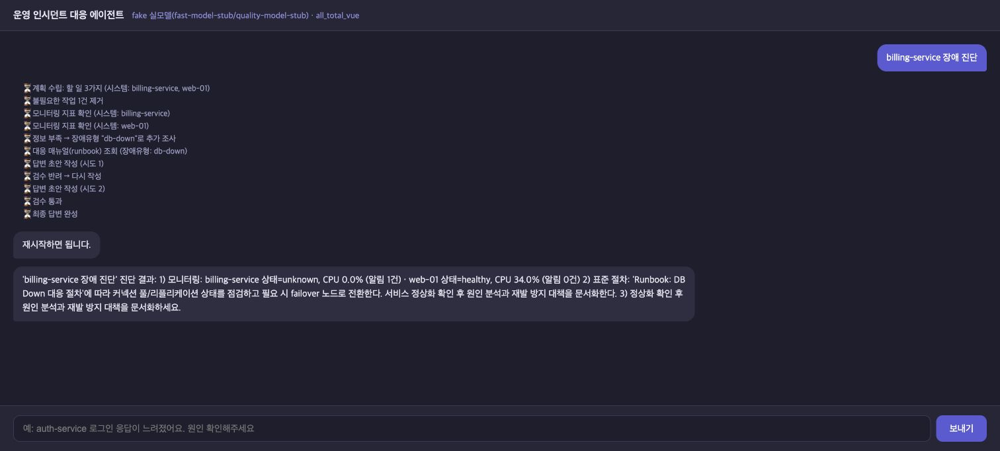

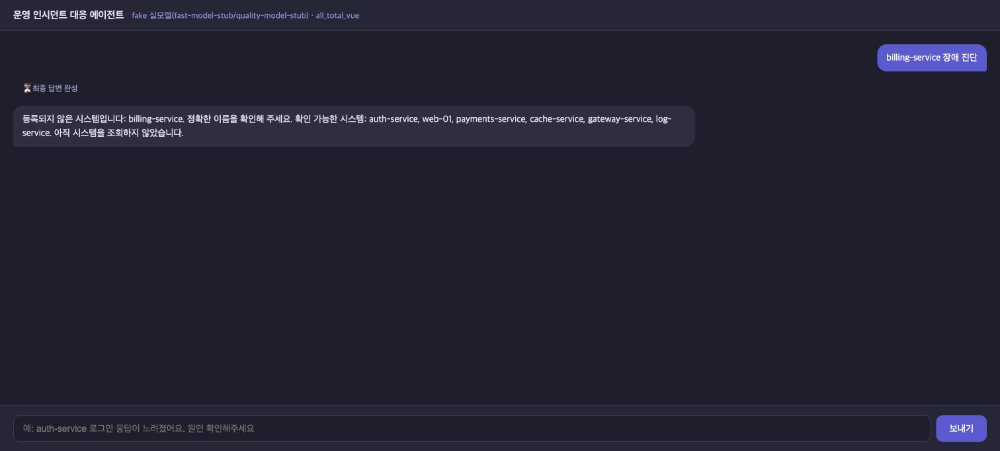

### 9.2 RAG: 같은 한국어 증상으로 런북 선택

같은 질문 `payments-service 장애 진단`, 합성 CPU 96.2%·알림 `프로세서 사용률 급증`, strict·fake 조건에서 분류기만 keyword/RAG로 바꿨다. keyword는 `db-down`, RAG는 `cpu-spike`를 선택했다. 임베딩은 실제 E5다. 이 한 쌍은 §4의 held-out 6문항 정확도와 별도 화면 사례다.

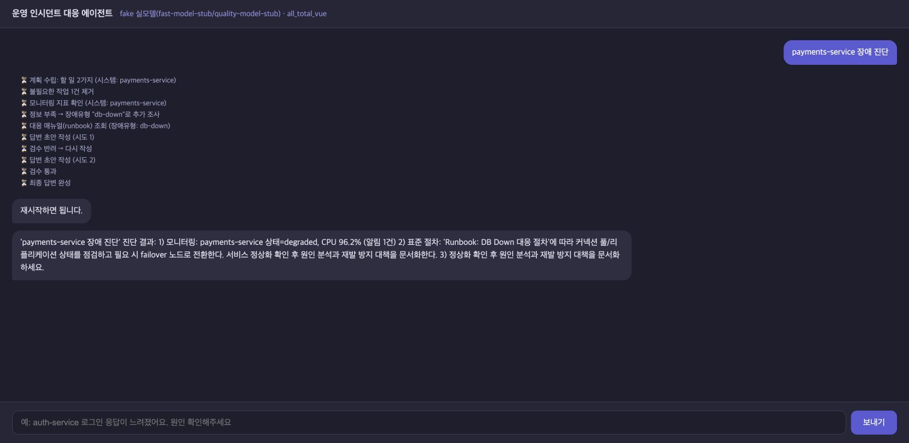

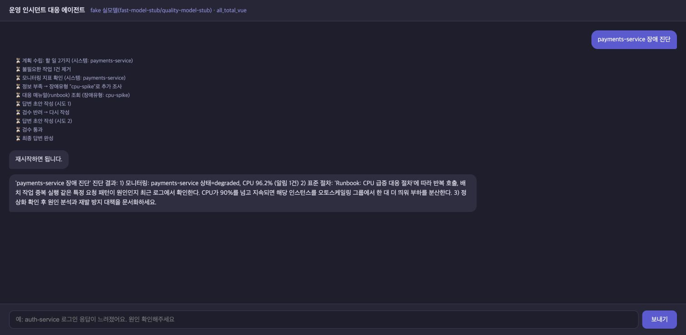

### 9.3 전문 조사: 출처와 부분 실패 표시

같은 질문 `payments-service 장애 진단`, 고정 stdio MCP·합성 CPU 91%·fake 조건에서 legacy/multi 조사를 비교했다. 지표·런북에 합성 로그 출처가 추가된다. 추가 화면은 로그 수집 실패를 실제 운영 로그 이상으로 해석하지 않고 부분 실패로 표시하는 동작이다.

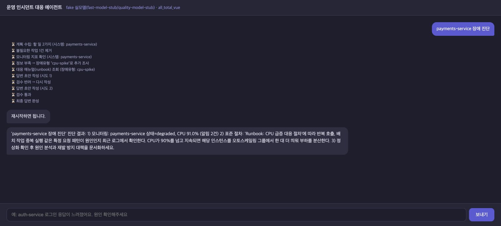

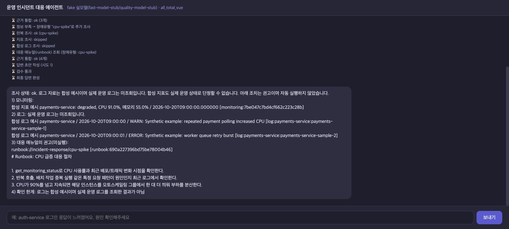

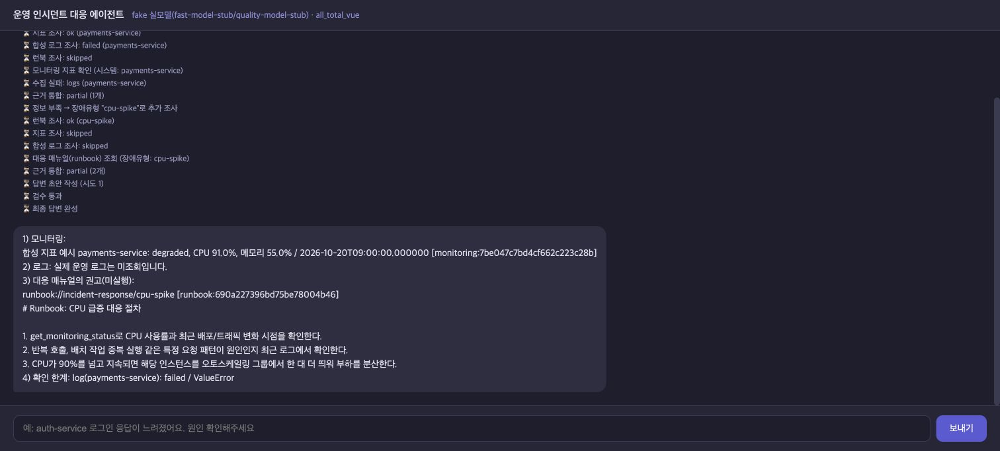

### 9.4 요약 메모리: 고정 이력에서 사실 회수

실제 Qwen 8B·고정 chat 라우팅·같은 12턴 이력에서 `앞서 말한 제 이름만 답해 주세요.`를 요청했다. recent는 `김민호`, summary는 원래 이름 `민수`를 답했다. §4의 5문항 집계 중 이름 회수 화면이며, 실제 라우팅 전체의 일반 성공률을 뜻하지 않는다. 토큰 증가와 새 Qwen 기억 실패 2건은 §4–5에 함께 기록했다.

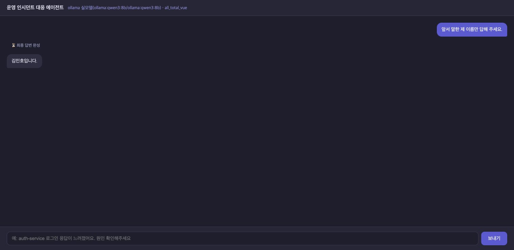


### 9.5 최종 통합 실행

별도 격리 서버에서 실제 Qwen 8B·strict·RAG·multi·summary를 함께 적용했다. Vue SSE 진단 완료와 근거·합성 여부·한계·미실행 권고 표시를 확인했다. 미등록 `ghost-service` 조회 차단도 확인했다. 최종 통합 화면은 위 고정 fixture 비교와 다른 조건이므로 지연이나 품질을 직접 비교하지 않는다.

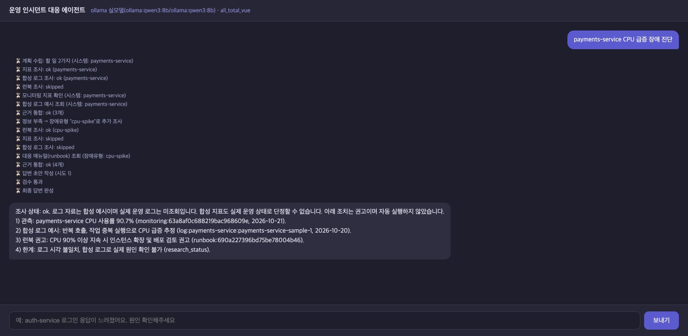

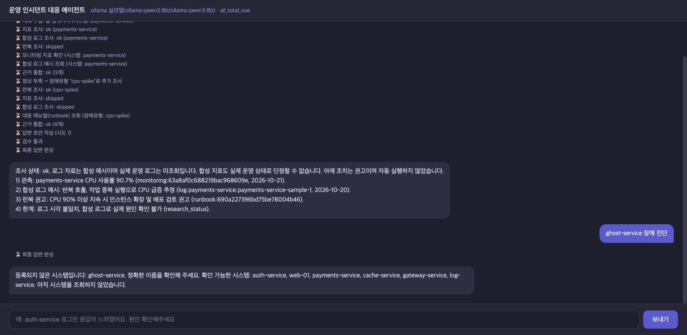

## 10. 구현에서 확인한 개선 포인트

전문 그래프를 나누면 수집 책임과 실패 원인을 추적하기 쉬워지지만, MCP 세션 잠금으로 실제 I/O가 직렬이므로 구조 분리 자체를 속도 개선으로 볼 수는 없었다. 요약의 형식·근거 ID 검사를 통과해도 초기 사실의 의미 보존이 보장되지 않았다. Judge가 모든 단계에 같은 점수를 준 결과도 있어, 모델 점수와 정책·출처 검사를 함께 확인해야 했다.

우선 개선할 항목은 **요약 의미 보존·회상 실패 재현 집합 확대**, **실제 운영 로그 연동**, **MCP 병목과 동일 조건 지연 계측**, **독립 모델을 통한 Judge 교차 검증**이다. 현재는 합성 데이터와 작은 평가 집합 범위에서만 결과를 해석한다.

### 후속 모델 검증 계획

1. Qwen 결과와 실패 사례를 보존한다.
2. **같은 저장 답변·근거·rubric으로 Judge만 OpenAI로 교체**해 사람 판정 일치와 평가 차이를 확인한다.
3. 별도 실험으로 **서비스 답변 생성 모델도 OpenAI로 교체**하고 S0부터 최종 버전까지 같은 입력·도구 데이터에서 비교한다.
4. 실행 전에 모델·호출 수·비용 상한을 정하고 지연·토큰·실제 과금·실패를 별도로 기록한다.

Judge 교체에 따른 점수 변화와 서비스 모델 교체에 따른 품질 변화를 혼동하지 않는다. 이 추가 검증은 아직 수행하지 않았다.
