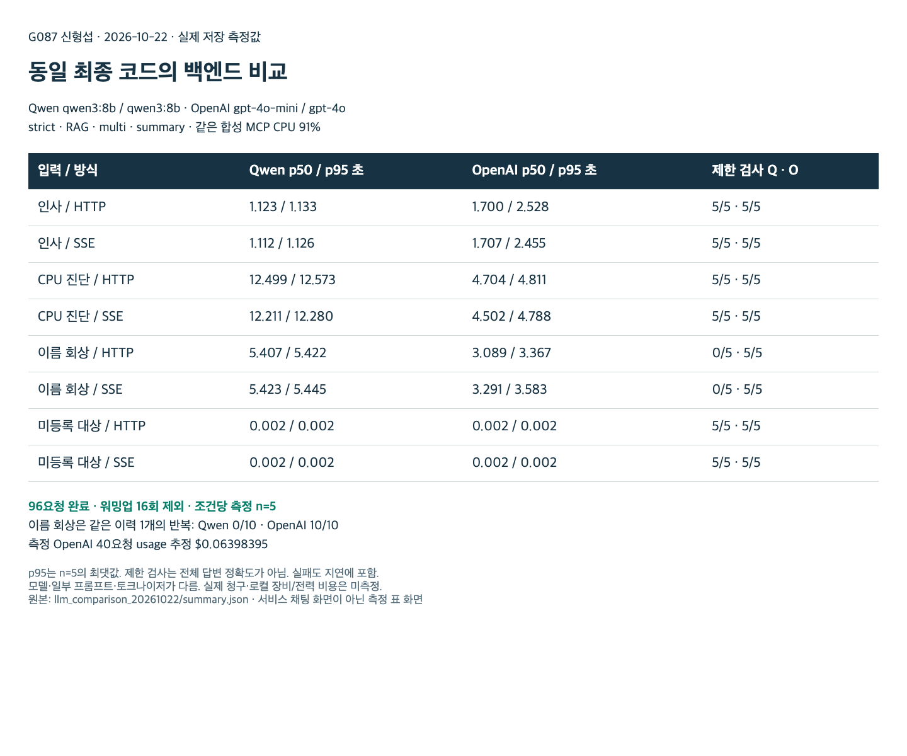

**G087 신형섭**

# 최종 버전 모델 교차 검증

2026-10-21~22. Qwen으로 구현·검증한 S0–S6를 유지하고 OpenAI 평가기 및 서비스 모델을 별도로 비교했다. 이 문서는 기존 [S6 Qwen 보고서](s6_integration_report.md)를 대체하지 않는 후속 결과다.

## 검증 순서와 결과

1. 저장 답변·근거·rubric을 고정하고 Judge만 교체했다. 사람 확인 네 범주 방향 일치는 Qwen과 OpenAI 모두 4/4였다. 수치 오류·허위 출처 주장을 OpenAI가 더 엄격하게 채점한 사례가 있지만 일반 정확도 개선으로 해석할 수 없다. 초기 JSON 어댑터 오류 호출을 보존하고 strict schema 수정 후 targeted 14건을 정상 채점했다.
2. OpenAI로 S0–S4/최종 소스를 재생하고 최종 통합 13/13, 재시작 원문·요약 영속성과 후속 회상을 확인했다. S5는 서비스 변경이 아닌 오프라인 평가다. Qwen 기존 통합 11/13과 기억 실패 2건을 보존했다.
3. 같은 합성 12턴 이력과 요약 지시를 사용한 재현에서 Qwen은 이름을 facts에 기록했지만 원문에 없는 근거 ID를 생성해 3/3 거부됐다. 최근 원문 fallback에는 초기 이름이 없어 회상 0/3이었다. OpenAI는 유효 요약·회상 3/3이었다. 아래 반복 측정과 다른 실험이다.
4. 최종 코드의 두 백엔드를 반복 측정하고 OpenAI 응답 대기 취소를 수정했다.

## 반복 측정 조건

- 동일 최종 서비스 코드, strict/v2/RAG/multi/summary, E5 인덱스와 고정 stdio MCP를 사용했다. 모니터링 CPU 91%, 로그·런북은 합성 데이터다. CPU 요청의 payload 24개가 같음을 검사했다.
- Qwen fast/quality: `qwen3:8b`/`qwen3:8b`. OpenAI: `gpt-4o-mini`/`gpt-4o` (실제 응답 alias 2024-07-18/2024-08-06).
- 인사·CPU·이름·미등록 대상 4입력 × HTTP/SSE × 2백엔드 × (워밍업1 + 측정5) = **96요청**. 워밍업16개를 제외한 측정80개다. 순차 실행하고 백엔드 순서를 번갈았다.
- 각 요청은 새 thread/격리 DB를 사용했다. 기억 질문만 같은 12턴 이력 1개를 넣었다. 출력 cap 2048은 실험 HTTP 경계에 적용했고 tracing은 껐다.
- 같은 설정 SHA `9b8fccf0281d1e253bfd2098ae4e15a624e1562458d3e011c859d095bd895cdd`, 인덱스 fingerprint `01e4dd3008fb06f05727737ddaa52b85999cadd60fda5d38b1d8c2ab4360408b`.
- 측정은 OpenAI 비동기 수정이 포함된 작업 트리에서 실행했다. 이후 서비스 수정 커밋 `e55bcee`로 보존했다. Python3.11.15, httpx0.28.1, Starlette1.9.0, FastAPI0.150.0, LangGraph1.2.16.

## 전체 측정표

지연은 요청부터 HTTP 본문/SSE DONE까지 초 단위다. p50은 중앙값, p95는 nearest rank이며 **n=5에서는 최댓값**이다. 토큰과 추정 비용은 해당 행의 측정 5회 합계다. 회상 실패도 지연 표본에서 제외하지 않았다.

| 백엔드 | 입력 | 방식 | n | p50 초 | p95 초 | 합계 토큰 | 제한 검사 | 추정 API 비용 |
|---|---|---|---|---|---|---|---|---|
| Qwen | 인사 | HTTP | 5 | 1.123 | 1.133 | 1,130 | 5/5 | $0.0000000 |
| Qwen | 인사 | SSE | 5 | 1.112 | 1.126 | 1,130 | 5/5 | $0.0000000 |
| Qwen | CPU 진단 | HTTP | 5 | 12.499 | 12.573 | 10,750 | 5/5 | $0.0000000 |
| Qwen | CPU 진단 | SSE | 5 | 12.211 | 12.280 | 10,750 | 5/5 | $0.0000000 |
| Qwen | 이름 회상 | HTTP | 5 | 5.407 | 5.422 | 4,960 | 0/5 | $0.0000000 |
| Qwen | 이름 회상 | SSE | 5 | 5.423 | 5.445 | 4,960 | 0/5 | $0.0000000 |
| Qwen | 미등록 대상 | HTTP | 5 | 0.002 | 0.002 | 0 | 5/5 | $0.0000000 |
| Qwen | 미등록 대상 | SSE | 5 | 0.002 | 0.002 | 0 | 5/5 | $0.0000000 |
| OpenAI | 인사 | HTTP | 5 | 1.700 | 2.528 | 1,085 | 5/5 | $0.0002077 |
| OpenAI | 인사 | SSE | 5 | 1.707 | 2.455 | 1,087 | 5/5 | $0.0002090 |
| OpenAI | CPU 진단 | HTTP | 5 | 4.704 | 4.811 | 10,061 | 5/5 | $0.0306936 |
| OpenAI | CPU 진단 | SSE | 5 | 4.502 | 4.788 | 10,115 | 5/5 | $0.0306979 |
| OpenAI | 이름 회상 | HTTP | 5 | 3.089 | 3.367 | 5,285 | 5/5 | $0.0010722 |
| OpenAI | 이름 회상 | SSE | 5 | 3.291 | 3.583 | 5,365 | 5/5 | $0.0011036 |
| OpenAI | 미등록 대상 | HTTP | 5 | 0.002 | 0.002 | 0 | 5/5 | $0.0000000 |
| OpenAI | 미등록 대상 | SSE | 5 | 0.002 | 0.002 | 0 | 5/5 | $0.0000000 |

프로토콜 완료·저장은 96/96 통과했다. 제한 검사는 비어 있지 않은 답변, CPU 근거 통합·합성 안내, 이름 정답 포함, 미등록 대상의 도구 미호출이다. 전체 문장의 사실 정확도나 Judge 평가 점수가 아니다.

**인사는 Qwen, CPU 진단은 OpenAI가 빨랐다.** 모델·일부 프롬프트·토크나이저가 달라 백엔드 프로필 비교다. 기억 회상 0/10 대 10/10은 서로 다른 이력 10개의 성공률이 아닌 같은 이력의 반복이다. 로컬 시간·네트워크·출력 길이와 작은 표본의 영향을 받는다. 동시 부하 시험은 수행하지 않았다.

이 화면은 실제 원시 집계값을 읽어 표시한 측정 결과 표다. 서비스 채팅 화면으로 사용하지 않는다. 구현 기능·최종 실행 캡처는 [루트 보고서](../../README.md)의 §9를 참조한다.

## 비용과 취소 검증

- 측정 OpenAI40요청 usage 추정 **$0.06398395**. 워밍업·중단 검증까지 포함한 이번 반복 측정 단계는 110호출, usage 확인104건/중단으로 미확인6건이다. 확인한 usage는 입력35,838·출력6,276토큰, 추정 **$0.07720670**다. 미확인 예약액을 포함한 보수적 예산 기록은 $0.15037170이다. 앞선 단계 비용과 섞지 않았다.
- 2026-10-22 확인한 일반 토큰 단가(1M input/output): mini $0.15/$0.60, 4o $2.50/$10.00. [OpenAI 가격](https://openai.com/api/pricing/). 캐시 할인·크레딧·세금은 반영하지 않았다. **실제 청구액은 조회하지 않았다.** 로컬 장비·전력·시간 비용도 미측정이다.
- OpenAI `chat/write`가 동기 HTTP로 이벤트 루프를 막던 경로를 공통 `httpx.AsyncClient` 경로로 바꿨다. 스레드 offload보다 취소 시 실제 연결을 정리할 수 있어 선택했다. 완성 답변 1회 전달 방식은 유지했다.
- API/프록시 실제 중단에서 OpenAI 요약/대화4건, quality write2건을 통과했고 Qwen 실제 생성 조각 이후 중단1건도 통과했다. 로컬 HTTP 대기 취소, 불완전 원문·요약 미저장과 같은 thread 후속 요청을 확인했다. 4개 요약/대화의 취소 관측은 약28~31ms였지만 polling 사례값이며 성능 개선율로 일반화하지 않았다.
- `route/plan/analyze`에는 동기 호출이 남는다. 원격 GPU 연산이나 과금의 중단을 확인한 결과가 아니다.

## 최종 코드 검증과 남은 과제

전체 로컬 **213 PASS / 13 XFAIL**, 공개 파일만 복사한 환경 **116 PASS / 5 XFAIL**. OpenAI 응답 취소·연결 정리·콜백 미호출·usage·HTTP401 전파 단위6개를 추가했다. 기존 XFAIL은 성공 수에 포함하지 않는다. 원시 trace·보고서 전용 도구는 로컬 보관하고 공개 서비스는 이에 의존하지 않는다.

다음 과제는 요약 의미 보존과 근거 ID 준수 평가 집합 확대, 실제 로그 연동, 남은 동기 호출의 취소 처리, 동시 부하·장기 실행 검증이다. 작은 합성 실험만으로 운영 배포 준비도나 모델의 일반 우열을 주장하지 않는다.
